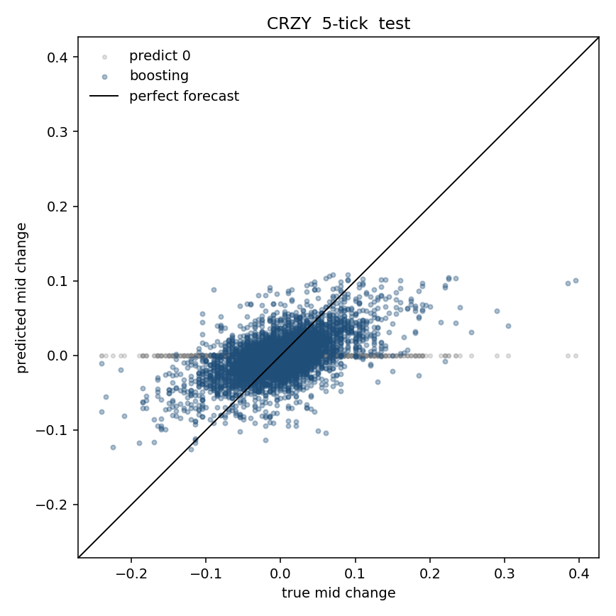
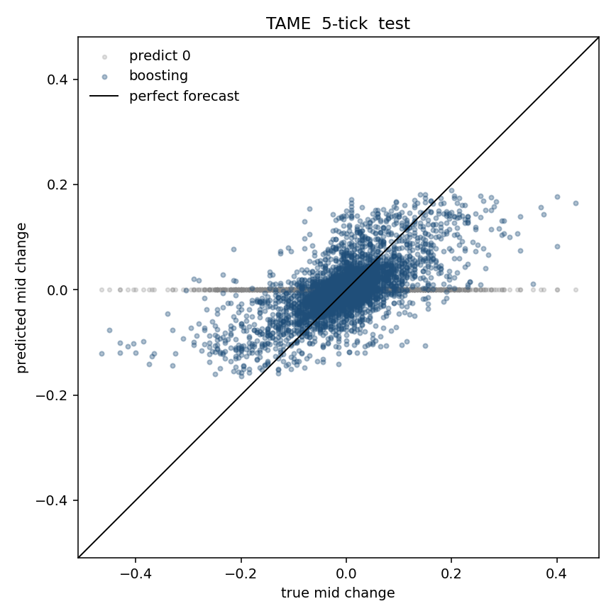
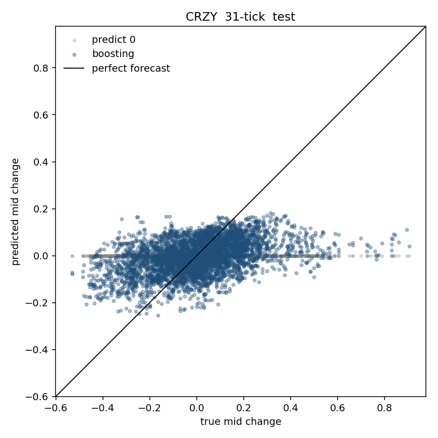
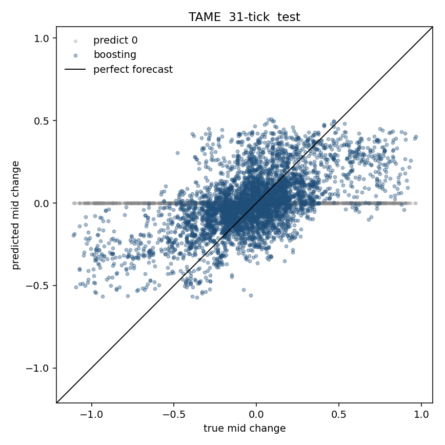
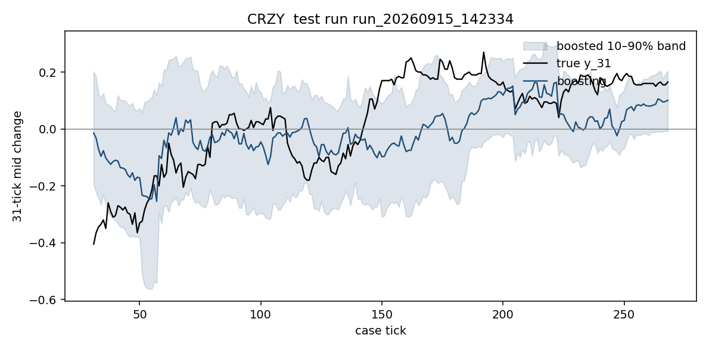
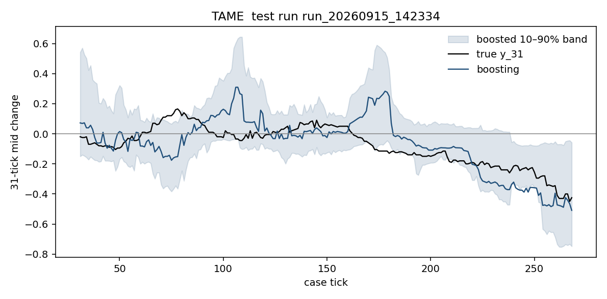

# Liability Trading 3: Price Forecasts and a 45-Tick Fill Trend

## Abstract

This project studies Liability Trading 3 (LT3) on the Rotman Interactive Trader using one hundred no-trade observation runs. The practical decision is whether to accept a large tender and then unwind the inventory. Before that rule can be scored, the mid path over the hedge horizon has to be forecast.

**Price models first.** Separate CRZY and TAME models forecast the mid change at 5 ticks (one hedge slice) and 31 ticks (recorded tender life). Histogram boosting and XGBoost beat a predict-zero baseline on held-out runs. 31-tick MAE is about **12.8 cents vs 14.3** for zero on CRZY, and **18.4 vs 22.2** on TAME. The useful 31-tick output is a 10th–90th percent band, not a point forecast of drift. Tape features matter for CRZY; nearby book depth matters for TAME.

**Trend overlay second.** A 45-tick average-fill label is then split into **up**, **down**, or **still** with stock-specific thresholds (about 45% of windows called a trend). Chosen classifiers reach about **55% balanced accuracy** on held-out runs, against a 33% random baseline. They are a directional check beside tender edge and the adverse band, not a stand-alone trading rule.

---

## 1. Problem statement

In LT3 the trader may be offered a tender for a large block of CRZY or TAME (typically 65,000–75,000 shares). Accepting creates inventory that must be unwound without having front-run the block. The economic question is whether the remaining edge after fees and book impact covers the price risk on the leftover shares.

Two forecasting problems, in order:

1. **Continuous mid change** over a short hedge slice (5 ticks) and over the recorded tender life (31 ticks). That is Section 4.
2. **Directional fill trend** over a slightly longer working horizon of 45 ticks, labeled up, down, or still. That is Sections 5–7.

The endpoint change is

```
y_H(t) = mid(t + H) − mid(t)
```

with `H` equal to 1, 5, or 31. That is the price-model label. If inventory is worked out along the path, a last-tick print is a weak proxy for hedge risk: early ticks matter more. The trend overlay therefore uses the **average fill move**—the average mid over the next 45 ticks minus the mid at the decision (Section 5).

---

## 2. Data

| Item | Detail |
|---|---|
| Source recording | `observation_ml.sqlite` (100 no-trade LT3 runs) |
| Feature panel | `price_features.sqlite` (end-of-tick quotes) |
| Batches | 20 runs in `batch_01`, 80 in `batch_02` |
| Names | CRZY (start price 10), TAME (start price 25) |
| Tenders | Five per run; all recorded as `EXPIRED` |
| Panel size | 59,988 rows (run × ticker × case tick) |
| Price labels | `y_1`, `y_5`, `y_31` in the panel |
| Split | Whole runs in time order: 60 train / 20 validation / 20 test |

Each panel row is the last `ACTIVE` quote of a case tick. Rolling windows never cross a run. Price-model training rows need a 31-tick history (`ret_31` filled) and a future label. Position, net liquidation value, and news do not vary in this file: the models describe the market when nobody takes the tenders. Labels are a **no-trade counterfactual**. Impact after an accept must be added separately when scoring an accept-or-decline rule.

The 45-tick fill label and lookbacks (`ret_45`, and so on) are built at train time in `train_trend_models.py`. They are not stored in `price_features.sqlite`.

---

## 3. Market facts

Measured on the last active quote of each case tick. Longer discussion: [`research/lt3_findings.md`](research/lt3_findings.md).

**Tender clock.** Tenders arrive in five fixed windows, each 16 ticks wide and 60 ticks apart: 14–29, 74–89, 134–149, 194–209, 254–269. Each run places exactly one tender in each window. In this recording every tender expires **31 ticks** after it appears. The windows do not overlap.

**Typical economics.** Median edge versus the mid is about 21 cents on the trader’s side of the trade; versus the touch, about 19 cents. After a $0.04 round-trip fee most tenders still look cheap on the quote. The touch holds about 6% of the block. A full sweep of visible depth walks a median 14 cents through the touch; one max-size order (25,000 CRZY, 10,000 TAME) walks about 3 cents.

**Names do not hedge each other.** One-tick and 31-tick mid changes of CRZY and TAME are essentially uncorrelated. Models are therefore fit **separately by ticker**.

**Persistence.** Holding risk is larger than a one-tick random walk, especially for TAME.

| | CRZY | TAME |
|---|---|---|
| One-tick mid-change std | 0.022 | 0.026 |
| 31-tick mid-change std | 0.176 | 0.308 |
| Variance ratio at 31 ticks | 2.1 | 4.6 |
| Median spread | 0.03 | 0.03 |

A 70,000-share leftover has a 31-tick price standard deviation of about 18 cents in CRZY and 31 cents in TAME—the same order as the 19-cent touch edge. TAME is the harder name: more multi-tick trend, and at least seven max-size orders to hedge a typical block.

---

## 4. Continuous mid forecasts (5-tick and 31-tick)

Labels on the end-of-tick panel:

```
y_5(t)  = mid(t + 5)  − mid(t)     one hedge slice
y_31(t) = mid(t + 31) − mid(t)     recorded tender life
```

`y_1` was fit as a diagnostic. Models: **predict 0**, ridge, histogram boosting, XGBoost, and a small LSTM. CRZY and TAME are separate. Split is the same 60/20/20 runs in time. Empty cells use the training median. Ridge and the LSTM use training-set z-scores; trees split on raw thresholds (returns are not scaled by 100).

The LSTM does not see all 80 columns. It reads the last 31 ticks of eight live series: `ret_1`, `spread`, `imb_touch`, `micro_gap`, `signed_vol_1`, `imb_5c`, `rvol_5`, `dist_start`.

Headline metrics are **MAE** and **RMSE** in cents, plus the share of runs whose MAE is below predicting 0. MSE is RMSE squared and is not ranked separately. R² is a diagnostic; adjusted R² is not used for trees or the LSTM. The 31-tick tender band is scored with **pinball loss** at the 10th and 90th percentiles. Scores: `price_model_results.sqlite`. Plots: `research/figures/`. Full keep-lists: [`research/lt3_findings.md`](research/lt3_findings.md).

**One tick.** MAE is about 1.1–1.5 cents for every model, including predicting 0. That is the size of the minimum quote step. One-tick direction is not a useful forecast; it is omitted from the tables below.

### 4.1 Validation (cents)

| Ticker | Horizon | Metric | Predict 0 | Ridge | Boosting | XGBoost | LSTM |
|---|---|---|---|---|---|---|---|
| CRZY | 5 | MAE | 3.51 | 2.90 | 2.88 | 2.88 | 2.90 |
| CRZY | 5 | RMSE | 4.87 | 4.00 | 3.99 | 4.00 | 4.02 |
| CRZY | 5 | runs beat 0 | — | 100% | 100% | 100% | 100% |
| CRZY | 31 | MAE | 12.73 | 11.98 | 11.83 | 11.80 | 11.80 |
| CRZY | 31 | RMSE | 16.92 | 15.39 | 15.33 | 15.35 | 15.39 |
| CRZY | 31 | runs beat 0 | — | 75% | 85% | 85% | 85% |
| TAME | 5 | MAE | 5.52 | 3.90 | 3.84 | 3.83 | 4.08 |
| TAME | 5 | RMSE | 8.07 | 5.63 | 5.60 | 5.59 | 5.99 |
| TAME | 5 | runs beat 0 | — | 100% | 100% | 100% | 95% |
| TAME | 31 | MAE | 24.91 | 21.14 | 20.93 | 20.75 | 21.22 |
| TAME | 31 | RMSE | 34.31 | 28.22 | 27.87 | 27.76 | 28.67 |
| TAME | 31 | runs beat 0 | — | 85% | 75% | 85% | 80% |

### 4.2 Held-out test (cents)

| Ticker | Horizon | Metric | Predict 0 | Ridge | Boosting | XGBoost | LSTM |
|---|---|---|---|---|---|---|---|
| CRZY | 5 | MAE | 3.77 | 3.11 | 3.06 | 3.06 | 3.09 |
| CRZY | 5 | RMSE | 5.19 | 4.24 | 4.17 | 4.17 | 4.24 |
| CRZY | 5 | runs beat 0 | — | 100% | 100% | 100% | 100% |
| CRZY | 31 | MAE | 14.26 | 13.05 | 12.81 | 12.85 | 12.93 |
| CRZY | 31 | RMSE | 18.63 | 16.95 | 16.84 | 16.81 | 16.87 |
| CRZY | 31 | runs beat 0 | — | 75% | 80% | 80% | 70% |
| TAME | 5 | MAE | 5.10 | 3.95 | 3.81 | 3.81 | 4.06 |
| TAME | 5 | RMSE | 7.65 | 5.75 | 5.68 | 5.67 | 6.02 |
| TAME | 5 | runs beat 0 | — | 100% | 100% | 100% | 95% |
| TAME | 31 | MAE | 22.21 | 18.56 | 18.52 | 18.41 | 18.51 |
| TAME | 31 | RMSE | 30.63 | 24.74 | 24.49 | 24.55 | 24.88 |
| TAME | 31 | runs beat 0 | — | 90% | 90% | 90% | 90% |

Test R² for boosting: **0.36** (CRZY, 5 ticks), **0.18** (CRZY, 31 ticks), **0.45** (TAME, 5 ticks), **0.36** (TAME, 31 ticks). Predicting 0 has R² near 0. Boosting and XGBoost produce nearly the same errors. The LSTM is close on CRZY and worse on TAME at five ticks.

Five-tick and 31-tick models beat guessing 0, but the 31-tick miss (about 13 cents CRZY, 18 cents TAME) is still the same order as the ~19 cent tender touch edge. The useful 31-tick output is the **band**, not a point forecast of drift.

### 4.3 31-tick pinball loss (cents, lower is better)

Stored in `price_model_results.sqlite` in dollars (the same units as `y_31`). The table below is multiplied by 100 so it matches the MAE tables.

| Split | Ticker | Quantile | Constant band | Boosted band | XGBoost band |
|---|---|---|---|---|---|
| validation | CRZY | 10th | 3.0 | 2.6 | 2.7 |
| validation | CRZY | 90th | 3.1 | 2.8 | 2.8 |
| validation | TAME | 10th | 6.1 | 4.7 | 4.9 |
| validation | TAME | 90th | 7.0 | 4.7 | 5.1 |
| test | CRZY | 10th | 3.3 | 2.8 | 2.9 |
| test | CRZY | 90th | 3.5 | 3.0 | 3.0 |
| test | TAME | 10th | 5.8 | 4.3 | 4.5 |
| test | TAME | 90th | 5.6 | 4.3 | 4.5 |

The tree bands stay tighter than a fixed percentile on test, especially for TAME.

### 4.4 Test plots

Predicted mid change versus the true change on the 20 test runs. Gray is predicting 0. Blue is boosting. The diagonal is a perfect forecast. The cloud sits near the origin: the models shrink toward zero and still beat a flat zero guess on MAE.









One test run at 31 ticks, with the boosted 10th–90th percent band:





### 4.5 Feature test

A group works if dropping it and refitting raises validation error by at least 0.05 cents **and** the error rises on a majority of the 20 validation runs. Columns inside a passing group are then shuffled on the full model; a column is kept if that shuffle also raises error by 0.05 cents. One-tick models are excluded. The test split was not used to pick features. Scores: `feature_tests.sqlite`.

**What worked**

- **CRZY:** tape. Boosting/XGBoost keep `last_print_mid` and `signed_vol_5`. Removing tape raises the 5-tick miss by about 0.07 cents and the 31-tick miss by about 0.05–0.08 cents.
- **TAME:** nearby depth, plus tape at five ticks. Removing depth raises the 5-tick miss by about 0.22 cents and the 31-tick tree miss by 0.40–0.55 cents. Kept columns include `depth_bid_5c`, `depth_bid_10c`, `imb_10c`, `imb_all`, not the whole 80-column ladder.
- **LSTM** (eight live series only): `ret_1` and `imb_5c` on both names.

**What did not**

The other stock, the clock, the max-order walk, and raw touch size almost never pass. Lagged returns as a block fail for ridge, boosting, and XGBoost because those models already have moving averages and RSI.

This keep-list is why the 45-tick classifier in Section 6 uses tape context for CRZY and book depth for TAME.

---

## 5. Trend definition and measurement

### 5.1 Fill move

At case tick `t`, for horizon `H = 45`:

```
y_fill_45(t) = average( mid(t+1), mid(t+2), ..., mid(t+45) ) − mid(t)
```

This is blank when a full 45-tick future does not exist inside the run (the case ends at tick 299). Relative to the endpoint `mid(t+45) − mid(t)`, the fill move down-weights a last-tick jump and up-weights a steady path—closer to an equal-slice unwind.

### 5.2 Stock-specific thresholds

A fixed five-cent cut is too small for both names and ignores TAME’s larger scale. Thresholds were chosen so that about **45%** of valid 45-tick windows are labeled as a trend (roughly 22% up and 23% down on each name):

| Ticker | Threshold | Up | Down | Still |
|---|---|---|---|---|
| CRZY | **8.9 cents** | fill > +8.9 cents | fill < −8.9 cents | otherwise |
| TAME | **13.1 cents** | fill > +13.1 cents | fill < −13.1 cents | otherwise |

Inside those labels, average fill moves are about **+16.0 / −17.2 cents** on CRZY and **+30.0 / −27.7 cents** on TAME. The bars differ because TAME’s fill-move distribution is wider.

Rows used for training require a filled 45-tick lookback (`ret_45`) and a full 45-tick future. Labels do not cross a run.

**Horizon caveat.** A full 45-tick future exists only through case tick 254. The fifth tender window (254–269) often cannot be scored with a 45-tick fill label before the case ends at 299. The recorded tender life remains 31 ticks; 45 ticks is a working-horizon choice for path risk after expiry begins to matter.

---

## 6. Trend classifier methods

### 6.1 Feature construction

Lookback features are matched to the **same 45-tick horizon** as the label. Short-horizon indicators and the live book remain as context. Feature choice follows the 31-tick ablation in Section 4.5: CRZY responds to tape; TAME responds to nearby depth. Missing values are filled with the **training-set median**.

**CRZY** (tape and trend context):

`ret_45`, `sma_dist_45`, `rvol_45`, `range_pos_45`, `signed_vol_45`, `print_vwap_dist_45`, `last_print_mid`, `signed_vol_5`, `rsi_5`, `rsi_14`, `boll_20`, `dist_start`

**TAME** (book depth plus horizon scale):

`ret_45`, `sma_dist_45`, `rvol_45`, `range_pos_45`, `imb_5c`, `imb_10c`, `imb_all`, `depth_bid_5c`, `depth_bid_10c`, `depth_bid_all`, `depth_ask_all`, `log_depth_all`, `dist_ask_l5`, `dist_bid_l5`

### 6.2 Models

Fit separately for each ticker on the run split.

| Model | Description |
|---|---|
| **baseline** | Always predict the training majority class (`still`) |
| **logistic** | Multinomial logistic regression on z-scored features, balanced class weights |
| **hgb** | Histogram gradient boosting on raw features, inverse-frequency sample weights |

Class weighting prevents the majority `still` class from dominating the fit.

### 6.3 Model selection

Validation **balanced accuracy** chooses between logistic and histogram boosting. For CRZY, logistic is kept when it is within two percentage points of the tree (validation was 50.3% boosting vs 49.3% logistic; logistic is clearly better on the test runs). **Chosen models: CRZY = logistic, TAME = histogram boosting.** Test metrics are reported once after selection. TAME logistic is slightly higher on test (55.4% vs 54.5%); that number was not used to pick the model.

### 6.4 Evaluation metrics

| Metric | Role |
|---|---|
| Accuracy | Share of correct labels (inflated by predicting `still`) |
| Balanced accuracy | Average of per-class recalls; random guessing is about 33% with three classes |
| Macro F1 | Unweighted mean of per-class F1 |
| Log loss | Quality of the probability vector (`p_down`, `p_still`, `p_up`) |
| Per-class precision / recall / F1 | How well each of up, down, and still is recovered |

Balanced accuracy is the primary selection metric because accuracy rewards always calling `still`.

---

## 7. Results (45-tick trend classifier)

Full validation and test tables, plus confusion matrices: [`research/trend_45_findings.md`](research/trend_45_findings.md). Scores: `trend_model_results.sqlite`.

### 7.1 Held-out test summary

| Ticker | Model | Accuracy | Balanced accuracy | Macro F1 | Log loss |
|---|---|---|---|---|---|
| CRZY | baseline (always still) | 49.9% | 33.3% | 0.222 | 1.049 |
| CRZY | **logistic (chosen)** | 50.2% | **55.4%** | 0.503 | 0.963 |
| CRZY | hgb | 49.7% | 49.9% | 0.487 | 1.016 |
| TAME | baseline | 55.5% | 33.3% | 0.238 | 1.003 |
| TAME | **hgb (chosen)** | 52.2% | **54.5%** | 0.507 | 0.994 |
| TAME | logistic | 49.3% | 55.4% | 0.492 | 0.996 |

Raw accuracy is close to the still baseline because still is about half the labels. Balanced accuracy is the informative number: both chosen models beat one-third by roughly twenty points.

### 7.2 Per-class recall (chosen models, test)

| Ticker | Model | Down recall | Still recall | Up recall |
|---|---|---|---|---|
| CRZY | logistic | 60.5% | 34.1% | 71.4% |
| TAME | hgb | 47.4% | 49.5% | 66.5% |

The models recover directional moves better than `still`. Confusions are concentrated between a mild path and a labeled trend—expected given thresholds near the center of the fill-move distribution.

### 7.3 Interpretation

The classifiers provide a usable **directional signal**. They are not accurate enough, and not designed, to accept or decline a tender alone. Probability outputs (`p_up`, `p_down`, `p_still`) should be read alongside remaining edge after the book walk and the $0.04 fee.

---

## 8. Implications for tender decisions

A practical overlay, not yet P&L-scored in this repository:

1. On tender arrival, compute remaining edge after walking the book for liftable size and subtracting the fee.
2. On leftover shares, charge an adverse price band (from the 31-tick quantile models in Section 4, or from historical fill-move tails).
3. Use the 45-tick trend class and probabilities as a **directional check**: adverse direction relative to inventory raises the bar for accept; favorable direction does not replace the band test.
4. Prefer a no-call when the top class probability is weak.

---

## 9. Repository layout and reproduction

| Path | Role |
|---|---|
| `observation_ml.sqlite` | Raw no-trade recordings |
| `build_price_features.py` | Builds the end-of-tick panel |
| `price_features.sqlite` | 80 features + `y_1`, `y_5`, `y_31` |
| `train_price_models.py` | Continuous mid forecasts and quantile bands |
| `price_model_results.sqlite` | Price-model metrics and predictions |
| `plot_test_forecasts.py` | Test-set forecast plots for the price models |
| `test_features.py` | Feature-group and column ablation |
| `feature_tests.sqlite` | Ablation scores |
| `train_trend_models.py` | 45-tick fill label, lookbacks, and classifiers |
| `trend_model_results.sqlite` | Trend metrics, predictions, chosen models |
| `research/lt3_findings.md` | Price-model findings |
| `research/trend_45_findings.md` | Trend-classifier findings |

**Rebuild the feature panel** (requires `observation_ml.sqlite`):

```bash
python build_price_features.py
```

**Retrain continuous price models, plots, and feature tests:**

```bash
python train_price_models.py
python plot_test_forecasts.py
python test_features.py
```

**Retrain the 45-tick trend classifiers:**

```bash
python train_trend_models.py
```

---

## 10. Limitations and next work

1. **No-trade paths.** Every tender in the file expired. Forecasts describe mid dynamics when the trader does not take the block; they do not include the trader’s own impact after accept.
2. **No exported live artifacts yet.** Fitted weights, scalers, and impute medians are not written to disk for a Rotman API loop; only offline scores are stored.
3. **Accept-or-decline P&L** against always-accept and always-decline has not been scored. That experiment should walk the recorded book, apply the fee, and ask whether remaining edge covers the adverse band on leftover shares—optionally gated by the trend probabilities.

---

## References within this project

- [`research/lt3_findings.md`](research/lt3_findings.md) — continuous price models, market measurements, feature tests
- [`research/trend_45_findings.md`](research/trend_45_findings.md) — 45-tick fill-trend classifier metrics and confusion matrices
