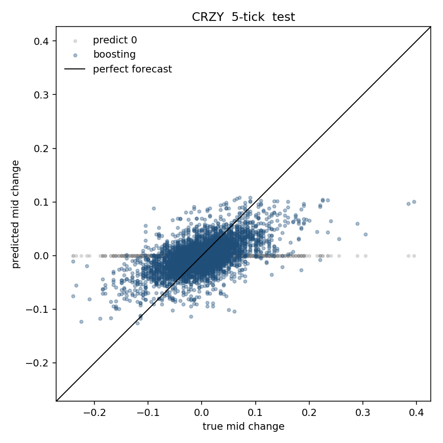
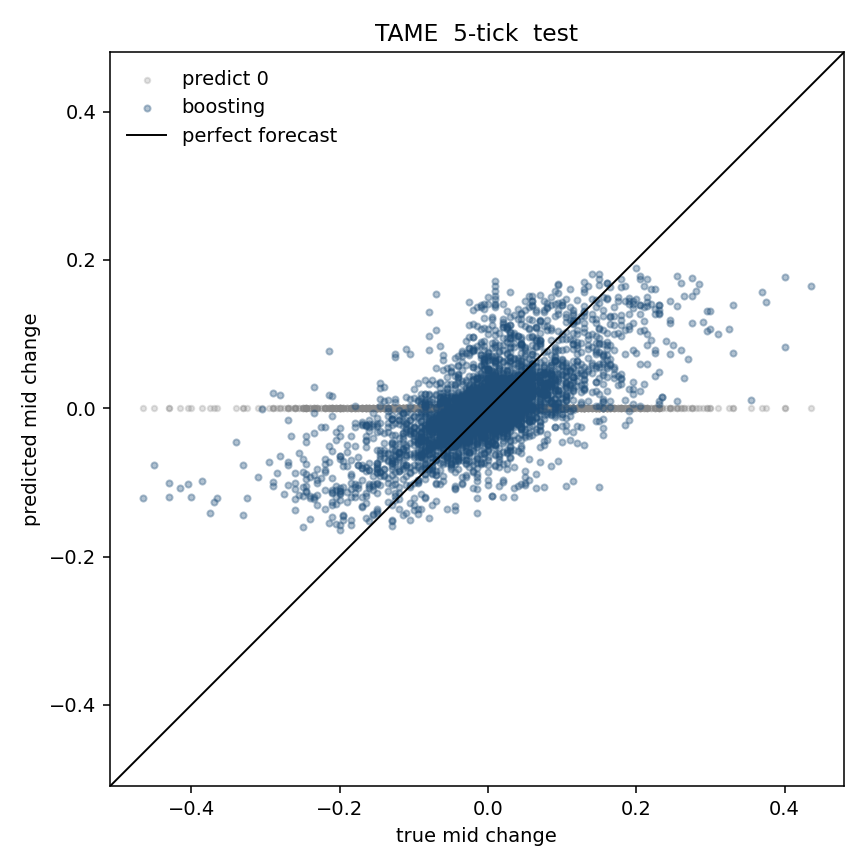
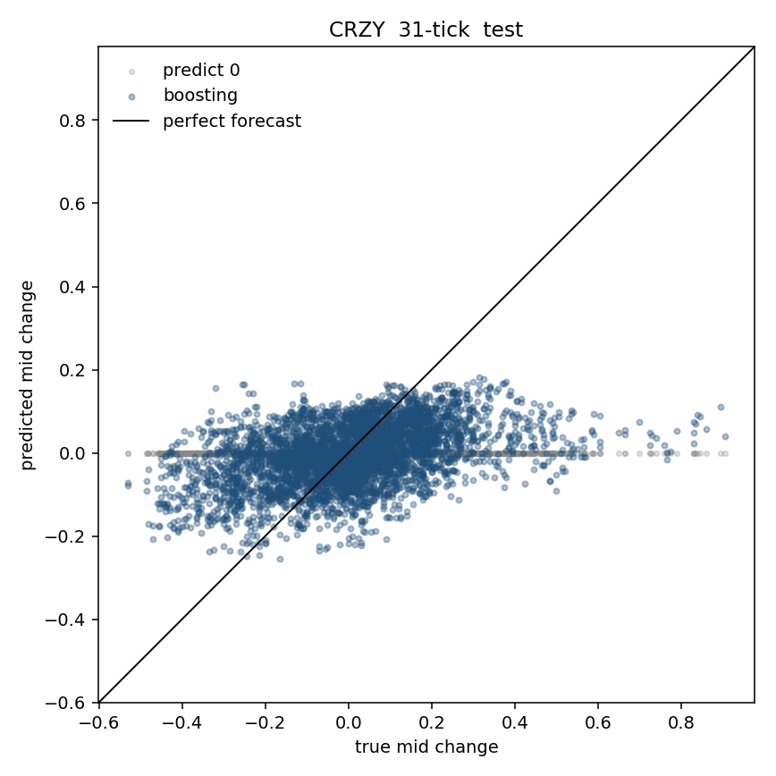
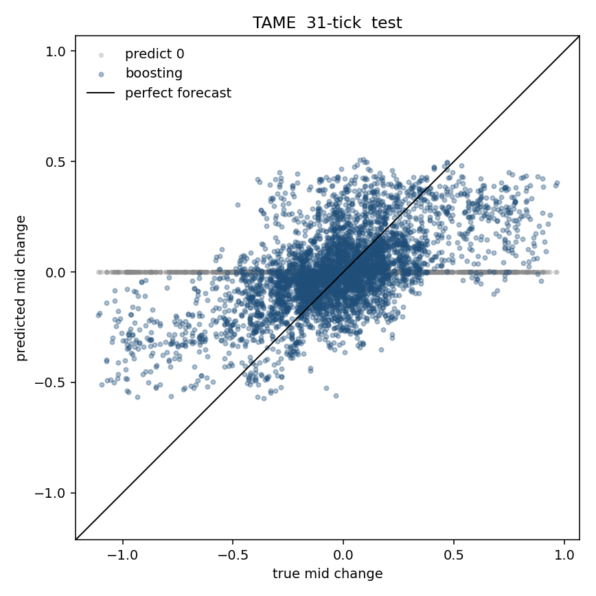
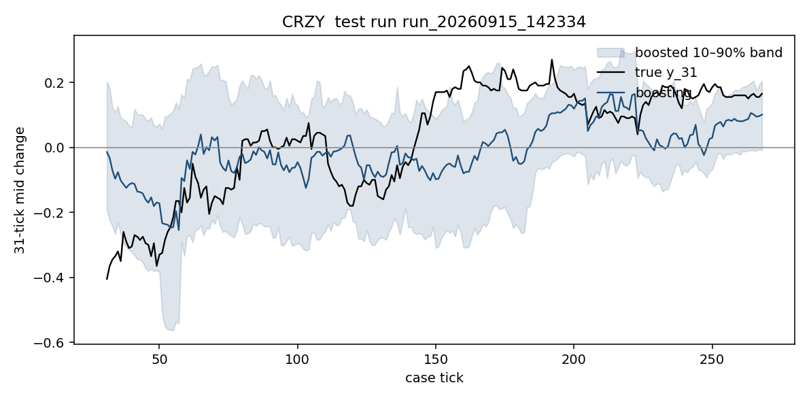
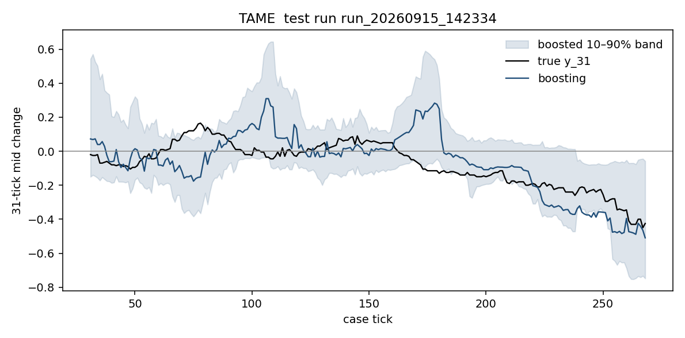

# Liability Trading 3: what a price model should forecast

Project record for the observation runs in this folder. It is not a trading recommendation.

## Question

Before an accept-or-decline rule, a price model should forecast the mid-price change over the horizon of the hedge, not whether CRZY or TAME will trend for its own sake. The case pays for unwinding a 65,000–75,000 share tender without front-running. The useful forecasts are:

- five ticks, about one max-size slice of the hedge
- 31 ticks, the recorded life of every tender in this file

The 1-tick change is a diagnostic only. Its typical size is one cent, the same as the smallest quote step.

## Data

One hundred no-trade recordings of Liability Trading 3 from `observation_ml.sqlite`, summarized as an end-of-tick panel in `price_features.sqlite`.

- 20 runs in `batch_01`, 80 in `batch_02`
- Two stocks, CRZY (start 10) and TAME (start 25)
- Five tenders per run, all recorded as `EXPIRED`
- One row per run, ticker, and case tick: 59,988 rows, 80 candidate features, labels `y_1`, `y_5`, `y_31`
- Split by time on the 100 runs: 60 train, 20 validation, 20 test
- Training rows require a 31-tick history (`ret_31` filled) and a future label. Windows do not cross a run.

Position, NLV, and news do not vary in this file. The models below describe the market when nobody takes the tenders.

## Market facts

Measured on the last `ACTIVE` quote of each case tick.

**Tenders arrive in five fixed windows**, 16 ticks wide and 60 ticks apart: 14–29, 74–89, 134–149, 194–209, 254–269. Each run places exactly one tender in each window. Every tender expires 31 ticks after it appears. The windows never overlap.

**The typical tender is through the market.** Median edge versus the mid is about 21 cents on our side of the trade. Median edge versus the touch is about 19 cents. After a $0.04 round-trip fee, most tenders still look cheap on the quote. The touch holds about 6% of the block. A full sweep of visible depth walks a median 14 cents through the touch. One max-size order (25,000 CRZY, 10,000 TAME) walks about 3 cents.

**The names do not hedge each other.** One-tick mid changes of CRZY and TAME have correlation about 0. The 31-tick changes are also close to uncorrelated.

**Holding risk is larger than a one-tick random walk**, especially for TAME.

| | CRZY | TAME |
|---|---|---|
| One-tick mid-change std | 0.022 | 0.026 |
| 31-tick mid-change std | 0.176 | 0.308 |
| Variance ratio at 31 ticks | 2.1 | 4.6 |
| Median spread | 0.03 | 0.03 |
| Volume per tick (median) | ~4,500 | ~4,400 |

A 70,000-share leftover position has a 31-tick price standard deviation of about 18 cents in CRZY and 31 cents in TAME. That is the same order as the 19-cent touch edge. TAME is the harder name: more multi-tick trend, and at least seven orders to hedge a typical block.

## Evaluation

Models are fit separately by ticker on the 80-column panel. The split is by whole run (60/20/20 in time). A row is the last `ACTIVE` quote of a case tick, with a 31-tick warmup. Empty cells are filled with the training median. Ridge and the LSTM use training-set z-scores. Boosting and XGBoost split on thresholds, so expressing a return in dollars or in cents does not change the tree; returns are not multiplied by 100.

The headline metrics are **MAE** and **RMSE** in cents of the stock price, plus the share of runs whose MAE is below predicting 0. MSE is RMSE squared and is not ranked separately. R² is reported as a diagnostic; adjusted R² is a linear-model statistic and is not used to score trees or the LSTM. The 31-tick tender band is scored with **pinball loss** at the 10th and 90th percentiles. Predicting 0 is the bar every model has to beat. One-tick MAE is about 1.1–1.5 cents for every model, including predicting 0, so that horizon is not used below.

Scores: `price_model_results.sqlite`. Test predictions: `test_predictions` in that file.

### MAE / RMSE (cents) and beat-zero, validation

| Ticker | Horizon | Metric | Predict 0 | Ridge | Boosting | XGBoost | LSTM |
|---|---|---|---|---|---|---|---|
| CRZY | 5 | MAE | 3.51 | 2.90 | 2.88 | 2.88 | 2.90 |
| CRZY | 5 | RMSE | 4.87 | 4.00 | 3.99 | 4.00 | 4.02 |
| CRZY | 5 | runs beat 0 | — | 100% | 100% | 100% | 100% |
| CRZY | 31 | MAE | 12.73 | 11.98 | 11.83 | 11.80 | 11.80 |
| CRZY | 31 | RMSE | 16.92 | 15.39 | 15.33 | 15.35 | 15.39 |
| CRZY | 31 | runs beat 0 | — | 75% | 85% | 85% | 85% |
| TAME | 5 | MAE | 5.52 | 3.90 | 3.84 | 3.83 | 4.08 |
| TAME | 5 | RMSE | 8.07 | 5.63 | 5.60 | 5.59 | 5.99 |
| TAME | 5 | runs beat 0 | — | 100% | 100% | 100% | 95% |
| TAME | 31 | MAE | 24.91 | 21.14 | 20.93 | 20.75 | 21.22 |
| TAME | 31 | RMSE | 34.31 | 28.22 | 27.87 | 27.76 | 28.67 |
| TAME | 31 | runs beat 0 | — | 85% | 75% | 85% | 80% |

### Same metrics, held-out test runs

| Ticker | Horizon | Metric | Predict 0 | Ridge | Boosting | XGBoost | LSTM |
|---|---|---|---|---|---|---|---|
| CRZY | 5 | MAE | 3.77 | 3.11 | 3.06 | 3.06 | 3.09 |
| CRZY | 5 | RMSE | 5.19 | 4.24 | 4.17 | 4.17 | 4.24 |
| CRZY | 5 | runs beat 0 | — | 100% | 100% | 100% | 100% |
| CRZY | 31 | MAE | 14.26 | 13.05 | 12.81 | 12.85 | 12.93 |
| CRZY | 31 | RMSE | 18.63 | 16.95 | 16.84 | 16.81 | 16.87 |
| CRZY | 31 | runs beat 0 | — | 75% | 80% | 80% | 70% |
| TAME | 5 | MAE | 5.10 | 3.95 | 3.81 | 3.81 | 4.06 |
| TAME | 5 | RMSE | 7.65 | 5.75 | 5.68 | 5.67 | 6.02 |
| TAME | 5 | runs beat 0 | — | 100% | 100% | 100% | 95% |
| TAME | 31 | MAE | 22.21 | 18.56 | 18.52 | 18.41 | 18.51 |
| TAME | 31 | RMSE | 30.63 | 24.74 | 24.49 | 24.55 | 24.88 |
| TAME | 31 | runs beat 0 | — | 90% | 90% | 90% | 90% |

Test-set R² for boosting is 0.36 (CRZY, 5 ticks), 0.18 (CRZY, 31 ticks), 0.45 (TAME, 5 ticks), and 0.36 (TAME, 31 ticks). Predicting 0 has R² of about 0. Boosting and XGBoost are the same model for this data. The LSTM is close on CRZY and worse on TAME at five ticks.

### 31-tick pinball loss (lower is better)

| Split | Ticker | Quantile | Constant band | Boosted band | XGBoost band |
|---|---|---|---|---|---|
| validation | CRZY | 10th | 0.030 | 0.026 | 0.027 |
| validation | CRZY | 90th | 0.031 | 0.028 | 0.028 |
| validation | TAME | 10th | 0.061 | 0.047 | 0.049 |
| validation | TAME | 90th | 0.070 | 0.047 | 0.051 |
| test | CRZY | 10th | 0.033 | 0.028 | 0.029 |
| test | CRZY | 90th | 0.035 | 0.030 | 0.030 |
| test | TAME | 10th | 0.058 | 0.043 | 0.045 |
| test | TAME | 90th | 0.056 | 0.043 | 0.045 |

The tree bands stay tighter than a fixed percentile on the test runs, especially for TAME.

### Test plots

Predicted 5-tick and 31-tick mid change versus the true change on the 20 test runs. Gray is predicting 0. Blue is boosting. The diagonal is a perfect forecast. The cloud sits near the origin: the models shrink toward zero and still beat a flat zero guess on MAE.

One test run at the 31-tick horizon, with the boosted 10th–90th percent band:

Ridge, boosting, and XGBoost were given all 80 features. The LSTM saw only eight live columns over the previous 31 ticks: `ret_1`, `spread`, `imb_touch`, `micro_gap`, `signed_vol_1`, `imb_5c`, `rvol_5`, `dist_start`. Feature cuts below use the validation runs. They were not rerun after these plots.

## Feature test

A group of features works if, after it is removed and the model is refit, validation error rises by at least 0.05 cents and the error rises on a majority of the 20 validation runs. One-tick models are excluded. Individual columns inside a working group are then shuffled on the validation rows of the full model. A column is kept when that shuffle raises error by at least 0.05 cents.

Scores are in `feature_tests.sqlite`. The keep list was chosen on validation. The test runs were not used to decide which features work.

### Groups that raised validation error

| Ticker | Horizon | Model | Group | Error rise (cents) | Runs where error rose |
|---|---|---|---|---|---|
| CRZY | 5 | hgb | tape | 0.07 | 80% |
| CRZY | 5 | lstm | ret_1 | 0.17 | 95% |
| CRZY | 5 | lstm | imb_5c | 0.13 | 85% |
| CRZY | 5 | lstm | signed_vol_1 | 0.06 | 75% |
| CRZY | 5 | ridge | tape | 0.08 | 85% |
| CRZY | 5 | xgb | tape | 0.05 | 75% |
| CRZY | 31 | hgb | tape | 0.08 | 55% |
| CRZY | 31 | hgb | volatility | 0.06 | 60% |
| CRZY | 31 | hgb_q10 | depth | 0.18 | 75% |
| CRZY | 31 | hgb_q10 | tape | 0.06 | 85% |
| CRZY | 31 | lstm | signed_vol_1 | 0.32 | 75% |
| CRZY | 31 | lstm | ret_1 | 0.15 | 65% |
| CRZY | 31 | lstm | rvol_5 | 0.14 | 75% |
| CRZY | 31 | ridge | trend | 0.20 | 70% |
| CRZY | 31 | ridge | tape | 0.07 | 70% |
| CRZY | 31 | xgb | tape | 0.05 | 60% |
| TAME | 5 | hgb | depth | 0.24 | 90% |
| TAME | 5 | hgb | tape | 0.10 | 80% |
| TAME | 5 | hgb | trend | 0.07 | 65% |
| TAME | 5 | lstm | ret_1 | 0.39 | 95% |
| TAME | 5 | lstm | imb_5c | 0.32 | 85% |
| TAME | 5 | ridge | depth | 0.21 | 85% |
| TAME | 5 | ridge | tape | 0.09 | 80% |
| TAME | 5 | xgb | depth | 0.23 | 90% |
| TAME | 5 | xgb | tape | 0.10 | 80% |
| TAME | 5 | xgb | trend | 0.07 | 75% |
| TAME | 31 | hgb | depth | 0.55 | 65% |
| TAME | 31 | hgb_q10 | depth | 0.15 | 60% |
| TAME | 31 | hgb_q10 | volatility | 0.05 | 55% |
| TAME | 31 | hgb_q90 | clock | 0.29 | 60% |
| TAME | 31 | hgb_q90 | depth | 0.25 | 70% |
| TAME | 31 | lstm | ret_1 | 0.82 | 55% |
| TAME | 31 | lstm | imb_5c | 0.32 | 60% |
| TAME | 31 | xgb | depth | 0.40 | 65% |

### Columns kept after shuffling

| Ticker | Horizon | Model | Column | Group |
|---|---|---|---|---|
| CRZY | 5 | hgb | `last_print_mid` | tape |
| CRZY | 5 | hgb | `signed_vol_5` | tape |
| CRZY | 5 | lstm | `imb_5c` | depth |
| CRZY | 5 | lstm | `ret_1` | returns |
| CRZY | 5 | lstm | `signed_vol_1` | tape |
| CRZY | 5 | xgb | `last_print_mid` | tape |
| CRZY | 5 | xgb | `signed_vol_5` | tape |
| CRZY | 31 | hgb | `last_print_mid` | tape |
| CRZY | 31 | hgb | `rvol_31` | volatility |
| CRZY | 31 | hgb_q10 | `depth_bid_10c` | depth |
| CRZY | 31 | hgb_q10 | `depth_bid_all` | depth |
| CRZY | 31 | lstm | `ret_1` | returns |
| CRZY | 31 | lstm | `signed_vol_1` | tape |
| CRZY | 31 | lstm | `rvol_5` | volatility |
| CRZY | 31 | ridge | `print_vwap_dist_31` | tape |
| CRZY | 31 | ridge | `signed_vol_5` | tape |
| CRZY | 31 | ridge | `boll_20` | trend |
| CRZY | 31 | ridge | `dist_start` | trend |
| CRZY | 31 | ridge | `range_pos_10` | trend |
| CRZY | 31 | ridge | `rsi_14` | trend |
| CRZY | 31 | ridge | `rsi_5` | trend |
| CRZY | 31 | ridge | `sma_dist_31` | trend |
| CRZY | 31 | xgb | `last_print_mid` | tape |
| TAME | 5 | hgb | `depth_ask_10c` | depth |
| TAME | 5 | hgb | `depth_bid_10c` | depth |
| TAME | 5 | hgb | `depth_bid_5c` | depth |
| TAME | 5 | hgb | `dist_ask_l5` | depth |
| TAME | 5 | hgb | `dist_bid_l5` | depth |
| TAME | 5 | hgb | `imb_10c` | depth |
| TAME | 5 | hgb | `last_print_mid` | tape |
| TAME | 5 | hgb | `signed_vol_5` | tape |
| TAME | 5 | hgb | `rsi_5` | trend |
| TAME | 5 | lstm | `imb_5c` | depth |
| TAME | 5 | lstm | `ret_1` | returns |
| TAME | 5 | ridge | `depth_ask_10c` | depth |
| TAME | 5 | ridge | `depth_ask_all` | depth |
| TAME | 5 | ridge | `depth_bid_10c` | depth |
| TAME | 5 | ridge | `depth_bid_all` | depth |
| TAME | 5 | ridge | `dist_ask_l5` | depth |
| TAME | 5 | ridge | `dist_bid_l5` | depth |
| TAME | 5 | ridge | `imb_10c` | depth |
| TAME | 5 | ridge | `imb_all` | depth |
| TAME | 5 | ridge | `log_depth_1c` | depth |
| TAME | 5 | ridge | `log_depth_2c` | depth |
| TAME | 5 | ridge | `log_depth_5c` | depth |
| TAME | 5 | ridge | `log_depth_all` | depth |
| TAME | 5 | ridge | `print_vwap_dist_31` | tape |
| TAME | 5 | ridge | `print_vwap_dist_5` | tape |
| TAME | 5 | ridge | `signed_vol_1` | tape |
| TAME | 5 | xgb | `depth_bid_10c` | depth |
| TAME | 5 | xgb | `depth_bid_5c` | depth |
| TAME | 5 | xgb | `dist_ask_l5` | depth |
| TAME | 5 | xgb | `dist_bid_l5` | depth |
| TAME | 5 | xgb | `last_print_mid` | tape |
| TAME | 5 | xgb | `signed_vol_5` | tape |
| TAME | 5 | xgb | `rsi_5` | trend |
| TAME | 31 | hgb | `depth_ask_all` | depth |
| TAME | 31 | hgb | `dist_ask_l5` | depth |
| TAME | 31 | hgb | `imb_10c` | depth |
| TAME | 31 | hgb | `imb_5c` | depth |
| TAME | 31 | hgb | `imb_all` | depth |
| TAME | 31 | hgb | `log_depth_all` | depth |
| TAME | 31 | hgb_q10 | `depth_bid_all` | depth |
| TAME | 31 | hgb_q10 | `dist_bid_l5` | depth |
| TAME | 31 | hgb_q10 | `imb_all` | depth |
| TAME | 31 | hgb_q10 | `log_depth_all` | depth |
| TAME | 31 | hgb_q90 | `tick_frac` | clock |
| TAME | 31 | hgb_q90 | `depth_ask_all` | depth |
| TAME | 31 | hgb_q90 | `dist_ask_l10` | depth |
| TAME | 31 | hgb_q90 | `imb_all` | depth |
| TAME | 31 | hgb_q90 | `log_depth_all` | depth |
| TAME | 31 | lstm | `imb_5c` | depth |
| TAME | 31 | lstm | `ret_1` | returns |
| TAME | 31 | xgb | `depth_ask_all` | depth |
| TAME | 31 | xgb | `dist_ask_l5` | depth |
| TAME | 31 | xgb | `imb_10c` | depth |
| TAME | 31 | xgb | `imb_all` | depth |
| TAME | 31 | xgb | `log_depth_all` | depth |

Tape is the group the CRZY tabular models actually use. Removing it raises the 5-tick miss by about 0.07 cents and the 31-tick miss by about 0.05–0.08 cents. After shuffling, the columns that remain are `last_print_mid` and `signed_vol_5`. TAME uses the book as well: depth raises the 5-tick miss by about 0.22 cents and the 31-tick tree miss by 0.40–0.55 cents. The columns that survive shuffling are nearby depth (`depth_bid_5c`, `depth_bid_10c`, `imb_10c`, `imb_all`) rather than the whole 80-column ladder.

The other stock, the clock, the max-order walk, and touch size almost never pass. Lagged returns as a block also fail for ridge, boosting, and XGBoost; those models already have moving averages and RSI. The LSTM is different: it only sees eight live series, so dropping `ret_1` or `imb_5c` hurts it on both names.

CRZY ridge at five ticks is the one case where a group passed (tape) and no single column then passed the shuffle rule. The tape block helps together. The 31-tick TAME upper band is the other exception: `tick_frac` passed inside the clock group, which is a path-shape effect in these 20 validation runs, not a reason to treat the clock as a price signal.

### Groups that did not pass

- CRZY 5-tick ridge: returns, trend, volatility, touch, depth, walk, clock, other
- CRZY 5-tick hgb: returns, trend, volatility, touch, depth, walk, clock, other
- CRZY 5-tick xgb: returns, trend, volatility, touch, depth, walk, clock, other
- CRZY 31-tick ridge: returns, volatility, touch, depth, walk, clock, other
- CRZY 31-tick hgb: returns, trend, touch, depth, walk, clock, other
- CRZY 31-tick xgb: returns, trend, volatility, touch, depth, walk, clock, other
- TAME 5-tick ridge: returns, trend, volatility, touch, walk, clock, other
- TAME 5-tick hgb: returns, volatility, touch, walk, clock, other
- TAME 5-tick xgb: returns, volatility, touch, walk, clock, other
- TAME 31-tick ridge: returns, trend, volatility, touch, depth, walk, tape, clock, other
- TAME 31-tick hgb: returns, trend, volatility, touch, walk, tape, clock, other
- TAME 31-tick xgb: returns, trend, volatility, touch, walk, tape, clock, other

## What remains

The next experiment is the accept-or-decline rule, scored against always-decline and always-accept. For each tender, walk the recorded book, add the $0.04 fee, and ask whether the remaining edge covers the 31-tick adverse band on the leftover shares. That comparison is not part of this note.
